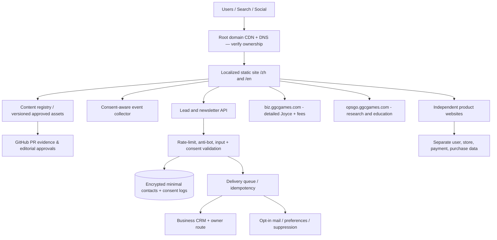

# GGC Website Architecture · 2026-10-11
## Logical architecture

## Platform proposal / decision pending
Target: **static-generated localized HTML** (e.g. Astro + TypeScript content collections) with narrowly scoped serverless APIs, deployed on hosting confirmed by the owner. This is a recommendation, not a currently completed migration. Existing `corporate/*.html` pages remain prototype/reference and root repo `CNAME` stays `biz.ggcgames.com` until root-domain ownership is verified.

## Content model
`Service{ id, slug, title{zh,en}, buyerProblem{zh,en}, inputs, deliverables, ownerRole, capacityCap, exclusions, priceReference, evidenceRefs, status, approvedBy, updatedAt }`  
`Product{ id, slug, name, pillar, category, ownershipType, maturity, maturityEvidence, copy{zh,en}, art{src,type,license}, gallery[], verifiedOfficialUrl, platforms, targetAudience, features, CTA, publicProofRefs, reviewedBy, verifiedAt }`  
`News{ id, locale, headline, date, sourceType, evidenceURL, claimState, publishedAt, approvedBy }`  
`Inquiry{ inquiryId, createdAt, company, name, email, track, stage, region, message, locale, source, consentAt, consentVersion, owner, CRMStatus }`  
`Subscriber{ email, locale, topics, pendingAt, confirmedAt, suppressionAt, consentVersion }`

**Source of truth**: `joyce/content/services.json` or `joyce/rate-card.csv` for published fee details, `sme/README.md` for canonical AI product names, approved evidence files for career/public speaking. Do not write independent price copies.

## API design (not yet implemented)
`POST /api/v1/inquiries` (validated, rate limited, idempotency key) → 201 only when persisted and acknowledged, with inquiryId. 400 invalid, 429 throttled, 5xx retryable. CRM failure must queue/retry and alert owner.
`POST /api/v1/newsletter/subscribe` → 202 Pending; verify by limited-life token; `/unsubscribe` must work without an account.
Static content endpoints optional: build product catalog into pre-rendered JSON. No per-filter backend call needed.

## Boundaries and privacy
- GGC corporate B2B lead records separate from product consumers and investment pipelines.
- CRM STOP and newsletter suppression separate and honored. Don't auto-enroll enterprise buyers in marketing emails.
- Consent-aware analytics; no PII in events, source URL or visible network requests.
- CSP, escaped output, WAF/rate limiting, secret management, least privilege, encryption and audit.
- Social, email and product outgoing destinations require availability and source audit.

## Release gates
1. Reconcile ten legal-company claims vs product brands/project tracks; verify public claims and screenshot rights.
2. Confirm `ggcgames.com` DNS/host, preserve `biz` and `opsgo` independently.
3. Ship preview/staging, test 390/768/1440 + English/Chinese routes, accessibility, all links and product status.
4. Implement genuine API+CRM+Newsletter and test end-to-end first; privacy/consent and official social URLs.
5. Confirm authorized deployment, observe traffic/404/mail deliverability, keep rollback ready.
