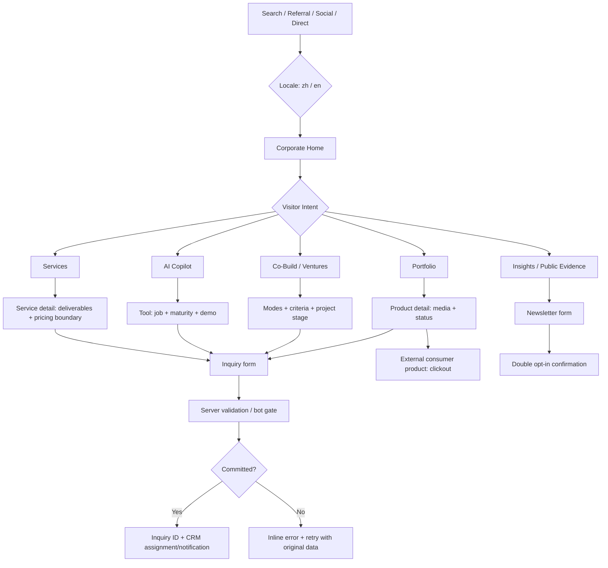
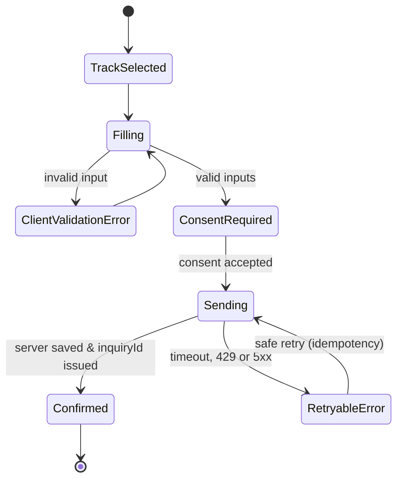
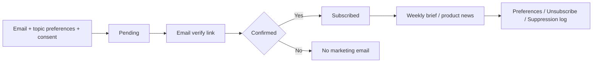

# GGC Website UX Flow — v1 · 2026-10-11
## Main funnel

## Persona journeys
| ID | Visitor | Flow | Outcome |
|---|---|---|---|
| F01 | Enterprise CEO | Home → Services → S12 detail → Contact (preselected) | Qualified operating partnership |
| F02 | Studio founder | Home → Ventures → Incubation → Contact | Reviewed joint project |
| F03 | Investor | Portfolio → Project Detail → Evidence → Capital Contact | Investor/industry discussion |
| F04 | AI tool buyer | Copilot → Product Workflow → Trial request | Verified pilot request |
| F05 | Consumer / KOL | Portfolio → Bunny → Official Product Site | External D2C navigation |
| F06 | Industry subscriber | Insights → newsletter preferences → pending → confirmed | Opted-in reader |

## Inquiry state machine

**Fields:** name, workEmail, company, partnershipTrack, region, stage, role, message, locale, optional website, consentVersion, consentAt, sourceCampaign (sanitized). Whitelist `track` and product/service referral; no unsolicited deck upload. Preserve user input on errors. Confirm only after real server acceptance.

## Newsletter states

**No automatic newsletter enrollment from inquiries.** Missing backend = visible honest interest-only registration.

## Interaction inventory
- Language switch: `/zh/portfolio/bunny/` ↔ `/en/portfolio/bunny/`, keep identity and non-sensitive referral fields.
- Mobile Nav: hamburger toggles dialog/drawer, focus trap, Esc close, active path, 44px touch targets.
- Product Filter: All / Games / Consumer AI / Software / Knowledge / Lifestyle. Empty state + clear button. Preferred shareable `?category=`.
- Product Detail: gallery / real vs concept asset labels / maturity badge / primary action / secondary partnership CTA.
- Contact: field errors, disabled on send, retry with idempotency, success receipt ID only after accepted.
- Newsletter: pending and confirmed are distinct.
- Analytics: separate qualified leads, AI tool pilots, consumer external clickouts, and confirmed subscribers.
