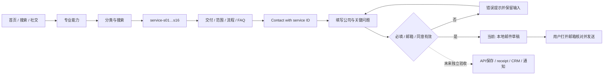
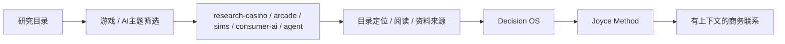
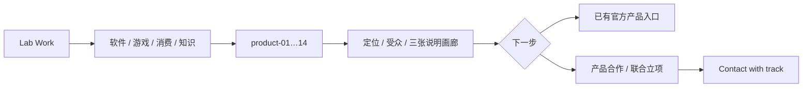

# GGC 全站 User Flow / 2026-10-12

保留已确认视觉与全站页面，不再从效果图猜业务。

## A. 企业商务

## B. 研究与决策

研究主题说明不是已经完成的新市场报告。原始数据、报告日期和公开权限逐份接入。

## C. 产品与合作

画廊有上一张、下一张、圆点、当前索引；说明图不改称App截图。

## D. 信任与方法
Home → Why GGC → 历史职责/肖像/愿景 → Book 或 Method → 公司合作。
Book的八主题来自给定著作海报；不是新增正式目录。Method保留Decide / Build / Compound、七模块与Diagnose / Prioritize / Build / Operate / Review / Scale-Stop / Codify。

## E. 动态与订阅
Updates → 主题、邮箱、同意 → 本地意向邮件 → 用户发送。
未来服务：pending → email confirmation → confirmed → preferences / unsubscribe；这些状态现在只在设计演示中显示，不触发真实订阅或确认回执。

## F. 全局状态
- 语言切换到同一深层页面；只携带安全service/track参数，不携带表单个人信息。
- 手机菜单打开/关闭/Escape，关闭后回到触发按钮。
- Tab使用role=tablist和roving tabindex；分类筛选使用aria-pressed而非冒充tab。
- 无结果时保持分类和输入、显示清空/重选指引。
- 错误URL进入404，并可回首页/联系；部署时404必须返回真正404状态。
- 禁用按钮不可触发；加载演示不会提交任何业务信息。

## 验收路径
两种语言分别执行：16服务筛选和深链；5研究详情；14产品详情与画廊；示例/标签/菜单键盘；空输入、错误邮箱、不同track、重复草稿、订阅状态演示、404返回。
